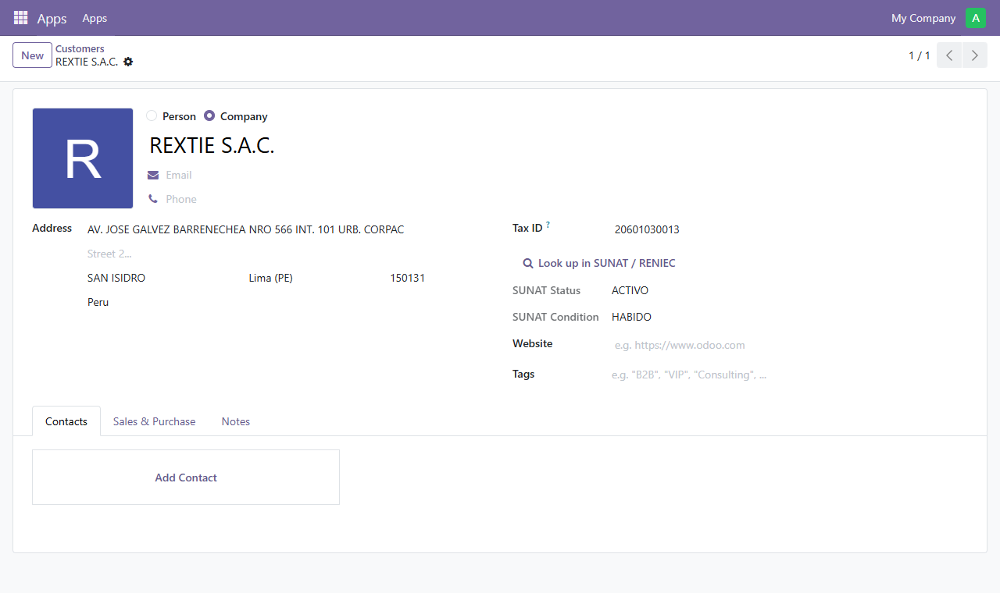
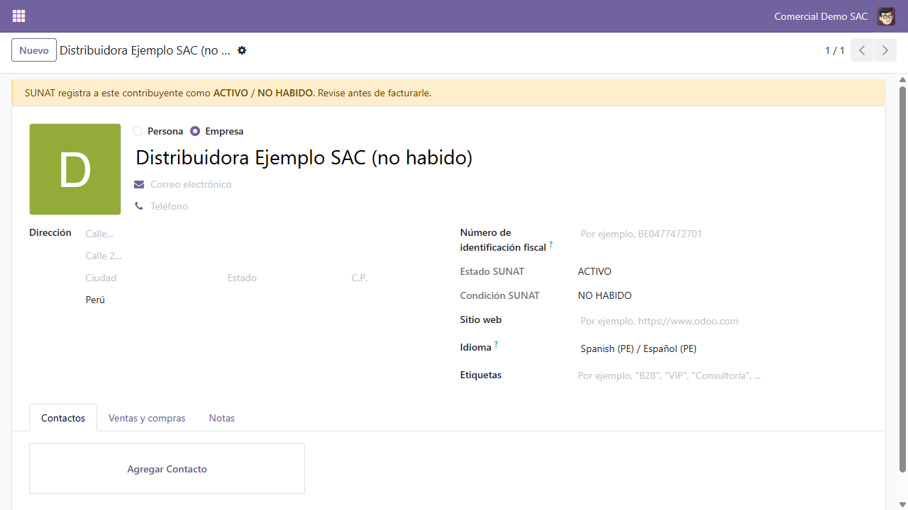
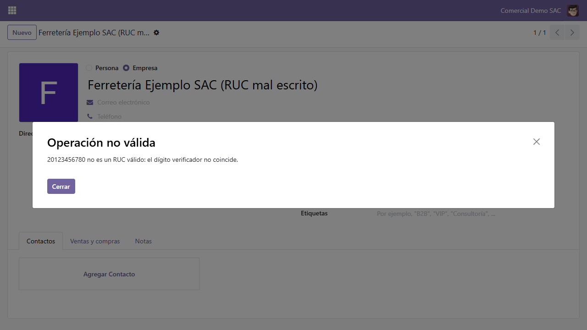

# l10n_pe_partner_lookup

[](https://github.com/sebpost2/l10n_pe_partner_lookup/actions/workflows/tests.yml)

An Odoo 19 addon for Peru: type a RUC or DNI on a contact, click once, and
the contact fills itself from SUNAT or RENIEC. A taxpayer that SUNAT doesn't
list as ACTIVO / HABIDO gets a warning before anyone invoices it. The data
comes from the [Decolecta](https://decolecta.com) API, so real lookups need
a Decolecta token.

> **En español:** escribes el RUC o DNI en el contacto, un clic, y Odoo trae
> la razón social, dirección y departamento desde SUNAT o RENIEC. Si el
> contribuyente no está ACTIVO / HABIDO, el contacto muestra una alerta antes
> de facturarle. El dígito verificador del RUC se valida localmente, sin
> gastar una consulta a la API.

## What it does

- **One-click lookup** next to the Tax ID field. 11 digits is a RUC
  (SUNAT), 8 digits is a DNI (RENIEC). Spaces, dots, dashes and a leading
  `PE` are ignored. A tax ID with any other character is refused instead of
  being reduced to its digits, so a foreign number is never looked up as if
  it were a DNI.
- **Local validation first**: the RUC prefix (10, 15, 16, 17, 20) and
  check digit are verified with `python-stdnum`, which ships with Odoo, so
  a mistyped number never spends an API call.
- **Fills the contact**: business name, address, district, ubigeo as ZIP,
  country, and the department, matched to Odoo's own Peruvian states by
  the first two digits of the ubigeo. SUNAT's `-` placeholders become empty
  fields instead of literal dashes. A DNI fills the person's name and the
  country.
- **ACTIVO / HABIDO guard**: SUNAT status and condition are stored on the
  contact; anything other than ACTIVO / HABIDO shows a warning banner.
  Editing the number in the contact form clears the old status, so the
  banner doesn't describe a different RUC.
- **Readable errors**: missing or rejected token, unknown number, timeout,
  server errors and answers that aren't a usable record each get a message,
  and none of them change the contact.
- **In Spanish too**: `i18n/es.po`, with the Latin American wording of
  Odoo's own contacts, so a Peruvian (`es_PE`) user sees the module and
  its messages in Spanish.





*Screenshots in Spanish (Peru). They use the sample record from
Decolecta's public API docs and fictitious companies; no live lookup was
made.*

## Stack

- Odoo 19 (Python), on the stock `odoo:19` Docker image, with PostgreSQL 16.
- `requests` for the HTTP call and `python-stdnum` for RUC validation. Both
  are already Odoo dependencies; the addon adds none.
- Odoo's own test framework (`TransactionCase`, `Form`) with
  `unittest.mock`.
- Docker Compose for local runs, GitHub Actions for CI.

## How it is built

Everything lives in `addons/l10n_pe_partner_lookup`:

- `models/res_partner.py` holds the whole flow. The button calls
  `action_pe_lookup`, which checks that the user may edit the contact,
  normalizes the Tax ID, validates a RUC locally, calls `_pe_fetch`, maps
  the answer with `_pe_ruc_values` or `_pe_dni_values`, and writes the
  contact once.
- `_pe_fetch` is the only HTTP code: a `GET` to
  `https://api.decolecta.com/v1/sunat/ruc` or `/reniec/dni` with the number
  as `numero`, a Bearer token and a 10-second timeout. It turns every
  failure into a `UserError` with a message for the user.
- Three fields are added to `res.partner`: `pe_sunat_state` and
  `pe_sunat_condition` (stored, read-only) and `pe_sunat_warning`
  (computed from the other two).
- `models/res_config_settings.py` exposes the token in Settings and stores
  it in the system parameter `l10n_pe_partner_lookup.token`.
- `views/` adds the button, the two status fields and the warning banner
  to the contact form, and the token field to General Settings.
- `data/demo.xml` has two fictitious contacts, `i18n/` the Spanish
  translation, `tests/` the test suite.

## Design decisions

- **Depends only on `base_setup`.** It works on any Odoo 19, with or
  without the full Peruvian accounting localization (`l10n_pe`), so a
  CRM-only database can use it too.
- **A button, not an onchange.** An HTTP call on every keystroke in the
  Tax ID field would be slow and would spend paid lookups on half-typed
  numbers. The user decides when to look up.
- **Nothing is spent that can be refused locally.** Write access to the
  contact, the format of the number and the RUC check digit are all checked
  before the HTTP call. A user who can read a contact but not edit it gets
  an access error and no request is made.
- **One write, at the end.** The answer is validated and mapped first, and
  the contact is written in a single call, so a failed lookup leaves it
  exactly as it was. An answer without a name is treated as "not found"
  rather than blanking the contact's name.
- **The token stays with administrators.** It is a system parameter, set
  from Settings and read with `sudo()` inside a private method, so regular
  users can run lookups without being able to read it.
- **The provider is one function.** `_pe_fetch` is the only code that knows
  about Decolecta's URL and authentication; switching to another RUC/DNI
  API means changing that method and the field mapping in `_pe_ruc_values`
  and `_pe_dni_values`, nothing else.

## Running it

```bash
docker compose up -d
docker compose exec odoo odoo -d pe_lookup -i l10n_pe_partner_lookup --with-demo --db_host=db --db_user=odoo --db_password=odoo --stop-after-init
```

Open `http://localhost:8069` (user `admin`, password `admin`). `--with-demo`
adds two fictitious contacts that work without a token: "Ferretería Ejemplo
SAC (RUC mal escrito)", whose lookup is refused locally for its check
digit, and "Distribuidora Ejemplo SAC (no habido)", which shows the
warning. For real lookups, go to Settings, General Settings, Contacts, and
paste a token from [decolecta.com](https://decolecta.com). Drop the flag
for an empty database.

## Running the tests

```bash
docker compose exec odoo odoo -d pe_lookup_test -i l10n_pe_partner_lookup --test-enable --test-tags /l10n_pe_partner_lookup --stop-after-init --db_host=db --db_user=odoo --db_password=odoo
```

The HTTP client is mocked in every test, so they need no token and no
network. They cover the local validation (check digit, prefix, length,
foreign tax IDs), the access check, the RUC and DNI field mapping, the
ACTIVO / HABIDO warning, every error path of the API call, the Spanish
translation and the form's onchange. CI runs them on every push against the
stock `odoo:19` image, once without and once with demo data, and fails if
the log doesn't show at least one test run with zero failures.

## Scope and known limits

Deliberately out of scope: caching lookups, bulk-updating existing
contacts, the RUC's annexed establishments (`locales_anexos`), and blocking
invoices for NO HABIDO taxpayers (it warns; the accountant decides).

Known limits of the current code:

- The stored SUNAT status is cleared when the number is edited in the
  contact form. A Tax ID changed by an import or through the API keeps the
  old status until the next lookup.
- A RUC with an unknown prefix is refused with the same "check digit does
  not match" message as a wrong check digit.
- A DNI is only checked for length before the lookup; it is not validated
  locally.
- Each click is one API request. Nothing is cached or retried.
