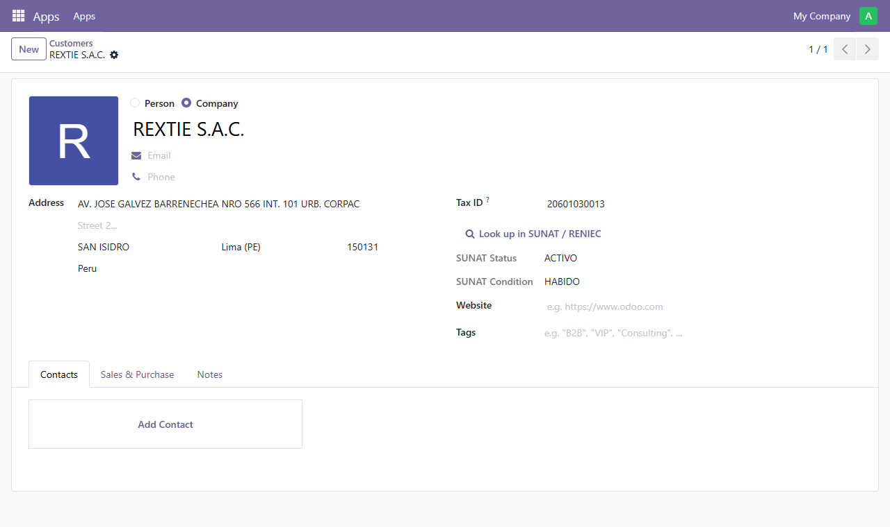
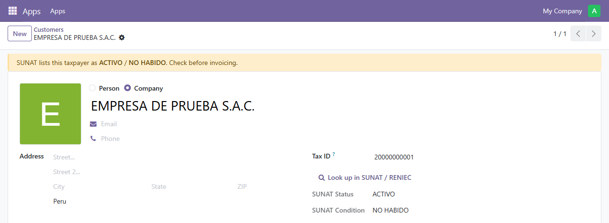
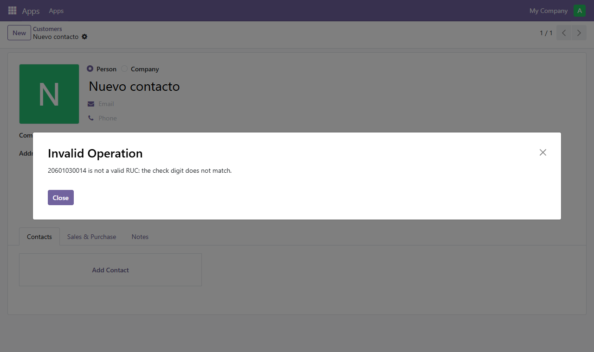

# l10n_pe_partner_lookup

[](https://github.com/sebpost2/l10n_pe_partner_lookup/actions/workflows/tests.yml)

**18 passing tests.** An Odoo 19 addon for Peru: type a RUC or DNI on a
contact, click once, and the contact fills itself from SUNAT or RENIEC. A
taxpayer that SUNAT doesn't list as ACTIVO / HABIDO gets a warning before
anyone invoices it.

> **En español:** escribes el RUC o DNI en el contacto, un clic, y Odoo trae
> la razón social, dirección y departamento desde SUNAT o RENIEC. Si el
> contribuyente no está ACTIVO / HABIDO, el contacto muestra una alerta antes
> de facturarle. El dígito verificador del RUC se valida localmente, sin
> gastar una consulta a la API.

## What it does

- **One-click lookup** next to the Tax ID field. 11 digits is a RUC
  (SUNAT), 8 digits is a DNI (RENIEC). Spaces and dashes are ignored.
- **Local validation first**: the RUC prefix (10, 15, 16, 17, 20) and
  check digit are verified with `python-stdnum`, which ships with Odoo, so
  a mistyped number never spends an API call.
- **Fills the contact**: business name, address, district, ubigeo as ZIP,
  country, and the department, matched to Odoo's own Peruvian states by
  the first two digits of the ubigeo. SUNAT's `-` placeholders become empty
  fields instead of literal dashes.
- **ACTIVO / HABIDO guard**: SUNAT status and condition are stored on the
  contact; anything other than ACTIVO / HABIDO shows a warning banner.
  Editing the number clears the old status, so it never describes a
  different RUC.
- **Readable errors**: missing or rejected token, unknown number, timeout
  and server errors each get their own message, and none of them change
  the contact.





*Screenshots use the sample record from Decolecta's public API docs and a
fictitious company; no live lookup was made.*

## Design decisions

- **Depends only on `base_setup`.** It works on any Odoo 19, with or
  without the full Peruvian accounting localization (`l10n_pe`), so a
  CRM-only database can use it too.
- **A button, not an onchange.** An HTTP call on every keystroke in the
  Tax ID field would be slow and would spend paid lookups on half-typed
  numbers. The user decides when to look up.
- **The provider is one function.** `_pe_fetch` is the only code that knows
  about Decolecta; switching to another RUC/DNI API means changing that
  method and the field mapping, nothing else.

## Running it

```bash
docker compose up -d
docker compose exec odoo odoo -d pe_lookup -i l10n_pe_partner_lookup --without-demo=all --db_host=db --db_user=odoo --db_password=odoo --stop-after-init
```

Open `http://localhost:8069`, then Settings, General Settings, Contacts, and
paste a token from [decolecta.com](https://decolecta.com).

## Running the tests

```bash
docker compose exec odoo odoo -d pe_lookup_test -i l10n_pe_partner_lookup --test-enable --test-tags /l10n_pe_partner_lookup --stop-after-init --without-demo=all --db_host=db --db_user=odoo --db_password=odoo
```

The HTTP client is mocked in every test, so they need no token and no
network. CI runs them on every push against the stock `odoo:19` image.

## Scope

Deliberately out of scope: caching lookups, bulk-updating existing
contacts, the RUC's annexed establishments (`locales_anexos`), and blocking
invoices for NO HABIDO taxpayers (it warns; the accountant decides).
